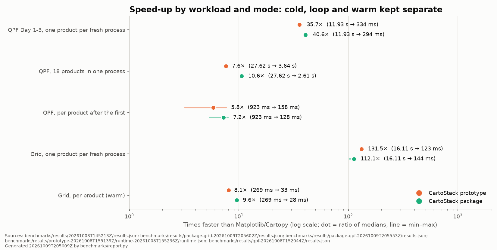

# CartoStack

Make the same map over and over, fast.

Weather and climate maps are often produced on a schedule: the coastlines, borders,
cities, logo and legend never change, only the data and a timestamp do. Redrawing all of
it with Matplotlib and Cartopy every time is slow. CartoStack draws the map **once**,
saves it as a layered `.cstack` file, and then builds each new map by swapping in just
the new data and stacking the layers into a PNG.

Think of it like a stack of transparent sheets: the basemap is drawn ahead of time, and
on every run only the data sheet and the title are replaced. Producing a map needs only
**NumPy and Pillow**, so it is quick to start, light to install, and never touches
Cartopy, shapefiles or Natural Earth data again.



On a precipitation-forecast map, one product takes about **0.3 s instead of 12 s**, and
the output matches the full Cartopy render to within a few colour levels on more than
99.9 % of pixels.

## Install

```bash
pip install cartostack            # make maps from .cstack files (NumPy + Pillow)
pip install "cartostack[build]"   # also create .cstack files (adds Matplotlib + Cartopy)
```

Requires Python 3.12 or newer.

## Usage

**1. Create the file once** from your existing Matplotlib/Cartopy figure:

```python
import math
from cartostack.build import SceneBuilder

fig, ax = draw_my_map()   # your existing Matplotlib/Cartopy code

b = SceneBuilder(fig, ax, dpi=150)
b.add_static("below", order=0, background=True, zorder=(-math.inf, 2))
b.add_grid_slot("temperature", order=10, lon=lon, lat=lat, cmap="coolwarm",
                vmin=-5, vmax=30, alpha=0.8, artists=[mesh])
b.add_static("above", order=20, zorder=(2, math.inf), artists=[title])
b.add_text_slot("subtitle", subtitle_artist, order=30)
b.save("temperature.cstack")
```

**2. Make a new map** whenever new data arrives:

```python
from cartostack import Scene

with Scene.load("temperature.cstack") as scene:
    scene.replace_grid("temperature", values)       # new 2-D array
    scene.text["subtitle"] = "Valid 2026-10-09 18:00 UTC"
    scene.save_png("temperature_18z.png")
```

Besides gridded data, a map can hold replaceable polygons (such as forecast contours),
text, and colorbars that update when the colour range changes. Complete examples are in
[`examples/`](examples/README.md).

## Documentation

- [API reference](docs/api.md)
- [File format specification](docs/format.md)
- [Contributing](CONTRIBUTING.md)

## License

MIT
