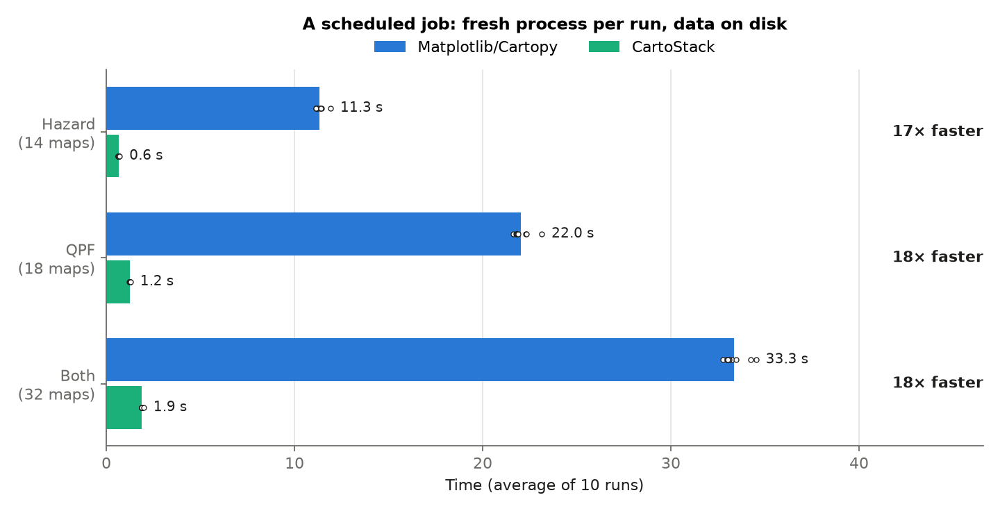

# CartoStack

CartoStack helps to build the base layers and structure of geoscience maps and figures over and over again without the overhead of redrawing all components every time. 

Weather and climate maps are often produced on a schedule. The coastlines, borders, cities, logo, and legend never change. Frequently on the data, title, and/or timestamp change. Redrawing all of it with Matplotlib and Cartopy every time is slow. CartoStack draws the map once, saves it as a layered `.cstack` file, and then builds each new map by swapping in only the new data and stacking the layers into a PNG.

The stack can be imagined as transparent sheets where the basemap is drawn ahead of time, and on every run only the data sheet and title are replaced. Producing a map needs only **NumPy and Pillow**, so it is quick to start, lightweight, and does not require Cartopy, shapefiles, or Natural Earth data repeatedly.



The figure times a scheduled job built from the [examples](examples/README.md): 14 daily
hazard maps from synthetic GeoTIFFs and 18 maps of public WPC precipitation forecasts, each
job in a fresh Python process, from data already on disk. The original Matplotlib/Cartopy
scripts take 33.3 s per run; CartoStack takes 1.9 s, using about a twentieth of the CPU time
and a third to a half of the memory. Times are the average of 10 runs on an Apple M3 Pro
(`benchmarks/cron_jobs.py`). They exclude the one-time step of building the `.cstack` files
from the existing scripts' figures (about 7–9 s per map layout), which is reused for every
later run.

**Is it a fit?** CartoStack helps most when the map layout stays the same from run to run,
many layers never change (basemap, borders, labels, logos, legends), only the data and a
few strings do, and the job runs often or makes many maps.

## Install

```bash
pip install cartostack            # make maps from .cstack files (NumPy + Pillow)
pip install "cartostack[build]"   # also create .cstack files (adds Matplotlib + Cartopy)
```

Requires Python 3.12 or newer.

## Usage

**1. Create the file once** from your existing Matplotlib/Cartopy figure. You don't rewrite
your plotting script; you wrap the figure it already makes:

```python
import math
from cartostack.build import SceneBuilder

fig, ax = draw_my_map()   # your existing Matplotlib/Cartopy code, unchanged

b = SceneBuilder(fig, ax, dpi=150)
b.add_static("below", order=0, background=True, zorder=(-math.inf, 2))
b.add_grid_slot("temperature", order=10, lon=lon, lat=lat, cmap="coolwarm",
                vmin=-5, vmax=30, alpha=0.8, artists=[mesh])
b.add_static("above", order=20, zorder=(2, math.inf), artists=[title])
b.add_text_slot("subtitle", subtitle_artist, order=30)
b.save("temperature.cstack")
```

**2. Make a new map** whenever new data arrives:

```python
from cartostack import Scene

with Scene.load("temperature.cstack") as scene:
    scene.replace_grid("temperature", values)       # new 2-D array
    scene.text["subtitle"] = "Valid 2026-10-09 18:00 UTC"
    scene.save_png("temperature_18z.png")
```

In addition to gridded data (including images drawn with `imshow`), a map can hold
replaceable polygons (such as forecast contours), text, colorbars that update when the
color range changes, and layers shown or hidden per run. Complete examples, including one
that wraps a script without editing it, are in [`examples/`](examples/README.md).

## Documentation

- [API reference](docs/api.md)
- [File format specification](docs/format.md)
- [Contributing](CONTRIBUTING.md)

## License

MIT
